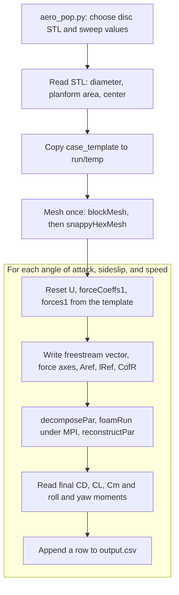

# Disc-Aero-Pipeline

**An automated OpenFOAM pipeline that sweeps a disc golf disc through angle of attack, sideslip, and airspeed and writes the force and moment coefficient table used by a 6-DOF flight simulator.**


Carter Tucker
Companion repo: [Disc-Flight-Simulator](https://github.com/CarterTucker/Disc-Flight-Simulator), the MATLAB 6-DOF simulator that consumes this pipeline's output.

---

## Overview

A flight simulator for a disc needs the aerodynamic force and moment on the disc for every orientation and airspeed it sees in flight. Producing that table by hand means setting up and running one OpenFOAM case per condition, which does not scale to a full sweep.

This pipeline automates it. For a chosen disc STL, it meshes the disc once. Then, for each combination of angle of attack, sideslip angle, and flow velocity, it sets the freestream vector, runs OpenFOAM in parallel, reads back the drag, lift, pitch, roll, and yaw coefficients, and appends them to [`scripts/output.csv`](scripts/output.csv), the lookup table the Disc-Flight-Simulator reads. The disc stays fixed in the mesh. Angle of attack and sideslip are applied by changing the direction of the incoming flow.

The default sweep is 12 angles of attack, 7 sideslip angles, and 5 speeds, 420 cases in total. It stays within the domain of flight: a thrown disc does not travel flat against its direction of motion, so angles such as 90 degrees are not simulated. Angle-of-attack spacing is finer (2.5 degrees) from -5 to 15 degrees, where discs spend most of their flight, and coarser (5 degrees) outside that range. All sweep values are plain lists in the driver script and can be changed.

The pipeline runs entirely in a terminal and has no user interface. Its only job is to produce `output.csv`.

## What It Produces

| Quantity | Value |
|---|---|
| Output file | [`scripts/output.csv`](scripts/output.csv) |
| Cases in the default sweep | 420 (12 angles of attack x 7 sideslip angles x 5 speeds) |
| Disc in the committed `output.csv` | `OverstableApproachDisc.stl` |
| Wall-clock time per case | min: 11.9s, max: 294.1s, avg: 40.5s|
| Total time for the full sweep | 4.73 hr (using 8 cores) |

| Column | Meaning | Units |
|---|---|---|
| `AoA` | Angle of attack | degrees |
| `Beta` | Sideslip angle | degrees |
| `U` | Freestream speed | m/s |
| `CD` | Drag coefficient | dimensionless |
| `CL` | Lift coefficient | dimensionless |
| `Cm` | Pitching moment coefficient | dimensionless |
| `Cl_roll` | Rolling moment coefficient | dimensionless |
| `Cn_yaw` | Yawing moment coefficient | dimensionless |
| `elapsed_sec` | Wall-clock time for the case | seconds |

Rows are written with `AoA` as the outer loop, then `Beta`, then `U`. A case that fails (a solver error or a timeout) is written with empty coefficient cells and its `elapsed_sec`.


## Pipeline



- [`scripts/aero_pop.py`](scripts/aero_pop.py) is the driver. It holds the disc choice and the sweep lists, loops over them, and writes `output.csv`. It refuses to start if `foamRun`, `mpirun`, or `decomposePar` processes are already running, and it skips any condition already present in `output.csv`, so an interrupted sweep can be restarted.
- [`scripts/run_case_v1.py`](scripts/run_case_v1.py) holds everything that touches OpenFOAM. `initialize()` deletes any old `run/temp/` and copies `case_template/` into it at the start of a sweep. `case_template/` itself is never modified. The temporary case is left in place afterward, and solver logs for the most recent case are in `run/temp/logs/`.
- [`case_template/`](case_template) is a complete OpenFOAM case that serves as the starting point.

| Function in `run_case_v1.py` | Role |
|---|---|
| `get_stl_dimensions` | Reads a disc STL from `disc_database/` (assumed to be in millimetres) and returns the diameter, planform area, bounding box, and bounding-box center. It also returns a mass (density 950 kg/m^3), `Izz`, and `Ixx`, which are not written to `output.csv`. |
| `initialize` | Replaces `run/temp/` with a fresh copy of the template. |
| `mesh_stl` | Copies the STL into the case, scales it to metres with `surfaceTransformPoints`, sets `locationInMesh`, then runs `blockMesh` and `snappyHexMesh -overwrite`. |
| `reset_flow_conditions` | Restores `0/U`, `system/forceCoeffs1`, and `system/forces1` from the template before each case. |
| `write_velocity_bc`, `write_force_coeffs`, `write_forces` | Write the case-specific values into those files (see [Template placeholders](#template-placeholders)). |
| `decompose_and_run_parallel` | Runs `decomposePar`, then `foamRun -solver incompressibleFluid` under `mpirun`, then `reconstructPar`. |
| `parse_force_coeffs` | Reads `CD`, `CL`, and `Cm` from the last row of `postProcessing/forceCoeffs1/0/forceCoeffs.dat`. |
| `parse_moment_coeffs` | Reads the pressure and viscous moments from the last row of `postProcessing/forces1/0/forces.dat` and projects them onto the drag and lift directions. |
| `single_case` | Runs one condition end to end. |

### Sweep domain

| Parameter | Values |
|---|---|
| Angle of attack | -10, -5, -2.5, 0, 2.5, 5, 7.5, 10, 12.5, 15, 20, 25 degrees |
| Sideslip angle | -15 to 15 degrees in 5 degree steps |
| Flow velocity | 8, 14, 20, 26, 30 m/s |
| Disc geometry | One STL per sweep, chosen with `FILENAME` in `aero_pop.py` |
| Spin rate | Not swept (no spin column in `output.csv`; constant spin rate between trials) |

## Method

### Applying the flow conditions

The disc is not rotated. For angle of attack $\alpha$ and sideslip angle $\beta$, the freestream velocity written into `0/U` is

$$\mathbf{U} = U\begin{pmatrix}\cos\alpha\cos\beta \\ \sin\beta \\ \sin\alpha\cos\beta\end{pmatrix}$$

In the case frame, the disc's plane is x-y and its axis is z (the diameter is taken from the x and y extents of the STL bounding box). The drag direction $\hat{\mathbf{d}}$ is the freestream direction, and the lift direction $\hat{\mathbf{l}}$ is the part of the z axis perpendicular to it:

$$\hat{\mathbf{l}} = \frac{\hat{\mathbf{z}} - (\hat{\mathbf{z}}\cdot\hat{\mathbf{d}})\,\hat{\mathbf{d}}}{\left\lVert \hat{\mathbf{z}} - (\hat{\mathbf{z}}\cdot\hat{\mathbf{d}})\,\hat{\mathbf{d}} \right\rVert}$$

### Coefficient definitions

With dynamic pressure $q = \tfrac{1}{2}\rho U^2$, reference area $A_\mathrm{ref} = \pi D^2/4$ (planform area from the bounding-box diameter $D$), and reference length $l_\mathrm{ref} = D$:

$$C_D = \frac{F\cdot\hat{\mathbf{d}}}{q\,A_\mathrm{ref}} \qquad C_L = \frac{F\cdot\hat{\mathbf{l}}}{q\,A_\mathrm{ref}} \qquad C_m = \frac{M_\mathrm{pitch}}{q\,A_\mathrm{ref}\,l_\mathrm{ref}}$$

$$C_{l,\mathrm{roll}} = \frac{M\cdot\hat{\mathbf{d}}}{q\,A_\mathrm{ref}\,l_\mathrm{ref}} \qquad C_{n,\mathrm{yaw}} = \frac{M\cdot\hat{\mathbf{l}}}{q\,A_\mathrm{ref}\,l_\mathrm{ref}}$$

$C_D$, $C_L$, and $C_m$ come from OpenFOAM's `forceCoeffs1` function object. $C_{l,\mathrm{roll}}$ and $C_{n,\mathrm{yaw}}$ are computed in Python from the total (pressure plus viscous) moment vector $M$ in `forces1`, using $\rho = 1.225$ kg/m^3. All moments are taken about the bounding-box center of the STL (not the computed center of mass). Each value is read from the last row of the OpenFOAM output, that is, the final iteration or time step, not an average.

### CFD setup

| Item | Detail |
|---|---|
| OpenFOAM | OpenFOAM Foundation distribution (the scripts call `foamRun -solver incompressibleFluid`). |
| Flow model | Incompressible solver module. |
| Turbulence model | kOmegaSST |
| Meshing | `blockMesh` for the background mesh, then `snappyHexMesh -overwrite` around the scaled STL, run once per disc and reused for every condition. `locationInMesh` is placed at (0, 2D, 0), outside the disc. |
| Parallelization | `decomposePar`, then `mpirun -np 6`. `numberOfSubdomains` in `system/decomposeParDict` must match the 6 processes. |
| Time limit | 600 s per case for `foamRun`. A case that exceeds it is stopped and recorded as failed. |
| Logs | One log per step in `run/temp/logs/`, overwritten by each case |

### Template placeholders

The scripts edit the temporary case by replacing exact lines of the template with case-specific values. The match is on the full line as written in the template, including its column spacing. If a line is edited in `case_template/`, the replacement silently does nothing, so change the template and the scripts together.

| File | Keyword and template value | Replaced with |
|---|---|---|
| `0/U` | `uniform (20 0 0)` | Freestream velocity vector |
| `system/forceCoeffs1` | `liftDir (0 0 1);` | Lift direction |
| `system/forceCoeffs1` | `dragDir (1 0 0);` | Drag direction |
| `system/forceCoeffs1` | `magUInf 20.0;` | Freestream speed |
| `system/forceCoeffs1` | `Aref 0.0316;` | Planform area |
| `system/forceCoeffs1` | `lRef 0.2006;` | Disc diameter |
| `system/forceCoeffs1` | `CofR (0 0 0.01);` | Bounding-box center of the STL |
| `system/forces1` | `CofR (0 0 0.01);` | Bounding-box center of the STL |
| `system/snappyHexMeshDict` | `locationInMesh (0.0 0.4011 0.0);` | (0, 2D, 0) |

## Repository Structure

```
Disc-Aero-Pipeline/
├── case_template/                 OpenFOAM case copied and edited for every sweep
│   ├── 0/                         Initial and boundary conditions: k, nut, omega, p, U
│   ├── constant/
│   │   ├── triSurface/disc.stl    Placeholder disc surface (replaced by the chosen STL)
│   │   ├── momentumTransport
│   │   ├── physicsProperties
│   │   └── transportProperties
│   └── system/
│       ├── blockMeshDict
│       ├── controlDict
│       ├── decomposeParDict
│       ├── forceCoeffs1
│       ├── forces1
│       ├── fvSchemes
│       ├── fvSolution
│       ├── residuals
│       └── snappyHexMeshDict
├── disc_database/                 Disc STL geometries (millimetres, disc axis along z)
├── scripts/
│   ├── aero_pop.py                Sweep driver; writes output.csv
│   ├── run_case_v1.py             OpenFOAM interface: geometry, meshing, case edits, solver, parsing
│   └── output.csv                 Lookup table consumed by Disc-Flight-Simulator
├── run/                           Generated at run time (temporary case and logs); not tracked
└── README.md
```

`case_template/`, `disc_database/`, and `scripts/` are located relative to the repository root by `run_case_v1.py`, so they must stay at the top level.

## Requirements

OpenFOAM is a command-line tool that runs on Linux, and this pipeline has no GUI, so everything below is done in a terminal.

- **Operating system:** Linux. The scripts use POSIX process groups and `pgrep`, so they will not run natively on Windows. They were written to run under Windows Subsystem for Linux (WSL). Ubuntu is the most direct route, because the OpenFOAM Foundation publishes Ubuntu packages.
- **Windows:** Install WSL, then follow the Linux steps inside it. From a Windows command prompt, `wsl --install -d Ubuntu-22.04` sets up Ubuntu.
- **macOS and other Linux distributions:** See the download pages at [openfoam.org](https://openfoam.org/download/) for options, including Docker images.
- **OpenFOAM:** Foundation distribution with `foamRun` and the `incompressibleFluid` solver module, plus `blockMesh`, `snappyHexMesh`, `surfaceTransformPoints`, `decomposePar`, and `reconstructPar`. 
- **MPI:** `mpirun` on the path.
- **Python:** Python 3 (3.13) and `numpy-stl` (`pip install numpy-stl`; note the package name, not `stl`). Everything else the scripts import is in the standard library.
- **Hardware:** The scripts run each case on 6 MPI processes, but can be changed as desired.

### Installing OpenFOAM on Ubuntu

```bash
sudo sh -c "wget -O - https://dl.openfoam.org/gpg.key > /etc/apt/trusted.gpg.d/openfoam.asc"
sudo add-apt-repository http://dl.openfoam.org/ubuntu
sudo apt-get update
sudo apt-get -y install openfoam14
```

Each new terminal session needs the OpenFOAM environment loaded before the pipeline is run:

```bash
source /opt/openfoam14/etc/bashrc
```

Check the current instructions at [openfoam.org/download](https://openfoam.org/download/) in case the repository details have changed.

## Running the Pipeline

1. Clone the repo.
2. Install OpenFOAM and load its environment (see above), and install the Python package: `pip install numpy-stl`.
3. In `scripts/aero_pop.py`, set `FILENAME` to an STL in `disc_database/`, and edit `aoa_list`, `beta_list`, and `velo_list` if you want a different sweep.
4. From a terminal, run the driver from the `scripts/` directory (it writes `output.csv` to the current directory):

   ```bash
   cd scripts
   python3 aero_pop.py
   ```

5. When the sweep finishes, the results are in `scripts/output.csv`.

Things to know when running:

- **Resuming.** Restarting the script skips any (`AoA`, `Beta`, `U`) already present in `output.csv`. Failed cases are recorded with empty cells, so they are also skipped on restart. Delete a failed row to have it retried.
- **One disc per output file.** `output.csv` has no disc column, and the resume check matches only on `AoA`, `Beta`, and `U`. Use a separate output file for each disc.
- **Stale processes.** If the script reports stale OpenFOAM or MPI processes, stop them before starting a sweep.

> **TODO:** The resume check in `aero_pop.py` reads `csv_path`, which is a hard-coded absolute path to one machine. Change it to the repository's `scripts/output.csv` (for example, `Path(__file__).parent / "output.csv"`) so resuming works in a fresh clone, then delete this note.

### Using the output with the flight simulator

Copy `output.csv` into the Disc-Flight-Simulator repository. The table is indexed by `AoA`, `Beta`, and `U`. **TODO:** state where the simulator expects the file, how it interpolates between rows, and how it handles empty cells from failed cases.

## Validation

- CFD results were exported as a CSV, which was used by my [Disc-Flight-Simulator](https://github.com/CarterTucker/Disc-Flight-Simulator). CFD parameter accuracy was based on the accuracy of the flight simulation.

## Limitations

- **Domain of validity.** The table only covers the swept conditions, and nothing is computed outside them. Spacing is 5 degrees in angle of attack outside -5 to 15 degrees.
- **Fixed mesh.** The mesh is generated once per disc and reused for all conditions, so any refinement is fixed in space while the flow direction changes with angle of attack and sideslip. 
- **Single-point results.** Coefficients are the final-iteration values, not an average over the end of the run. 
- **No side force.** Sideslip is swept, but only drag, lift, and the pitch, roll, and yaw moments are recorded.
- **Fixed constants.** Air density in the roll and yaw coefficients is fixed at 1.225 kg/m^3, and the mass properties returned by `get_stl_dimensions` assume 950 kg/m^3.
- **Geometry assumptions.** STLs are read in millimetres with the disc axis along z, and the reference length is the bounding-box diameter.
- **Failures and time limit.** A case that exceeds 600 s, or that errors, is recorded as an empty row rather than a partial result.
- **Platform.** The scripts need Linux, or WSL on Windows.

**Future work:** Improve the UI

## Why I Built This

Check out [Disc-Flight-Simulator](https://github.com/CarterTucker/Disc-Flight-Simulator). My disc flight project began with the MATLAB simulator, but I felt like the project was incomplete. I was limited in what I could simulate to the aero numbers in the research paper linked in the [Disc-Flight-Simulator](https://github.com/CarterTucker/Disc-Flight-Simulator) repo, and I wanted to simulate my own discs. For this reason, I began work on automating CFD, because running 420+ trials for each disc, by hand, was absolutely unrealistic. I have plans to design and manufacture my own discs, and I hope to use ML, in conjunction with my project, to inform design changes to reach a specific flight.

## What I Learned

Once I had a basic simulator model, I began working on this project in parallel, watching tons of YouTube videos for setting up OpenFOAM and running the first tests, and refreshing myself on using Python to writing files and running subprocesses. Most of what I learned was related to the OpenFOAM itself, because I do have experience using Ansys CFD for a project in the past. Once the basic program was setup, I spent a lot of time optimizing the script and simulation to reduce the time to fully characterize the discs. I ran the programs on parallel processors and changed my meshing strategy (changing the effective wind orientation relative to the disc, rather than the STL orientation relative to the effective wind to avoid remeshing between trials with different angles of attack and sideslip angles). Though the process isn't perfect, I can completely characterize a disc with enough resolution for its trajectory to be accurately predicted, in less than 5 hours.

## Citation

```bibtex
@misc{tucker2026discaero,
  author = {Tucker, Carter},
  title  = {Disc-Aero-Pipeline: Automated OpenFOAM Aerodynamic Coefficients for Disc Golf Discs},
  year   = {2026},
  url    = {https://github.com/CarterTucker/Disc-Aero-Pipeline}
}
```

## Acknowledgments

Not applicable.

## Contact

Carter Tucker: [LinkedIn](https://www.linkedin.com/in/carter-tucker-36083b32a/)
